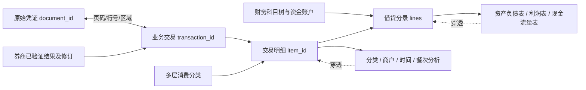

# CFO 数据模型与识别字段对照稿

状态：供用户讨论的设计稿，尚未迁移线上数据库或改变既有记账规则。
核查依据：本仓库 schema.sql、lib/ledger.mjs、lib/documents.mjs、lib/reports.mjs；不是对 NAS 当前数据完整性的实测报告。

## 1. 产品目标与最小分析单位

用户上传各种原始凭证，系统记录可追溯的事实，按账户、财务科目、消费分类、时间、商户等维度汇总，并能从汇总穿透到某笔交易、分项和原件所在页/位置。识别只是向这个模型填值，不能反过来让工具回执格式决定数据结构。

三个ID分别保留：

- document_id：一份原始文件的ID，图片/PDF/文档按内容哈希去重；文件名改变不产生新经济事实。
- transaction_id：一笔经济业务的ID，继续沿用现有 cfo_events.id，不重新编号既有交易。它可以有多份证据，也可以暂未入账。
- entry_id：正式会计记账凭证/分录组ID，已有 cfo_entries.id。已入账记录不可覆盖，纠错以冲销和更正留痕。

一个银行流水PDF可以支持多笔交易；一笔支付也可能有订单截图、支付截图和银行流水三份证据。这是多对多关系，不是一张图等于一笔交易。一笔交易可进一步拆成多条明细；报告的可加总最小分析单位是带金额的交易明细，而非文件。

## 2. 关系与查询路径

目标路径示例：本月费用 → 餐饮 → 外食 → 某周 → 午餐 → 某商户 → 交易明细 → 原截图或PDF具体页。月份、餐次、商户是可组合的筛选维度，不必全部硬编码成分类树节点。

资产负债表按期初余额与之后借贷变动计算；利润表反映收入费用；现金流量表反映实际现金变动。流入不必然是收入，流出不必然是费用；借款、还本金、本人转账、退款、非现金估值须有各自业务语义。

## 3. 现有结构与缺口

| 已有表/字段 | 当前实际职责 | 需要补足 |
|---|---|---|
| cfo_documents | 文件ID、SHA、文件名、类型、大小、存储位置、归档时间 | 凭证类型、出具机构、账单覆盖期、处理状态、页级定位 |
| cfo_events | 交易ID、主凭证、幂等键、状态、revision、payload JSON | 将常用检索字段结构化；交易方向/时点精度；多分项 |
| cfo_event_sources | 同笔交易关联多份文件及 source_ref | 页码/行号/区域、明细级证据、字段级证据；结构化来源关联 |
| payload.kind/date/amount/currency | 业务种类、日期、金额、可选原币 | 具体时间与精度、价值日、退款关联、数据验证状态 |
| payload.account_id/counter_account_id | 单笔来源/对方账户 | 一笔业务多次结算、第三方支付渠道与真实资金账户分离 |
| payload.category | 一个平面收入/费用科目键 | 多层科目、多层消费分类、分项分类 |
| payload.merchant/description/external_id | 商户、简述、外部交易号 | 规范商户及对手方、餐次/场景、可追溯分析维度 |
| payload.needs_review / issues | 整笔文字疑问 | 每个字段的缺失、冲突、来源和确认状态 |
| cfo_accounts | 资金账户与系统会计科目同表，已有五类分组 | 显式角色、父级、机构/脱敏标识；不按名称推断账户 |
| cfo_entries / cfo_lines | 双重记账、原币/人民币金额及汇率；冲销不可变审计 | 分录关联 item_id，支持分析明细穿透；现有金额不重写 |
| cfo_audit | 创建、修改、入账、冲销轨迹 | 分类与字段确认变动的审计 |
| cfo_account_results 等 | 券商只读、带来源与修订的账户结果 | 与正式账户映射、期间/汇率/覆盖核对后再生成分录 |

当前结构已经能做凭证归档、交易草稿、平面分类和三表，但尚不能完整实现多级分类、餐次分析、明细分摊和字段级溯源。只补一张回执汇总表并不能补齐这些缺口。

## 4. 原始凭证字段

以下为逻辑字段名草案；不表示已在数据库建列。

| 字段 | 内容 | 必填规则 | 当前情况/通常来源 |
|---|---|---|---|
| document_id | 原始文件唯一ID | 归档必有 | 已有，系统生成 |
| sha256 | 文件内容哈希 | 归档必有 | 已有，系统计算 |
| filename / mime_type / bytes | 原文件名、类型、大小 | 归档必有 | 已有，平台/文件 |
| stored_path | NAS内部存储位置 | 归档必有 | 已有，仅通过受鉴权下载接口访问 |
| document_type | 支付截图、订单、银行流水、券商结单等 | 可未知 | 新增，按可见内容识别 |
| issuer | 支付机构、银行或券商 | 可未知 | 新增，按抬头识别 |
| period_start / period_end | 账单覆盖期 | 账单类可识别时填 | 新增，不替代逐笔交易日期 |
| page_count | 页数 | 能解析时填 | 新增；图片可为1，不能伪造PDF已解析 |
| processing_status | 待识别、部分完成、完成、失败 | 系统必有 | 新增，基于提取覆盖及校验，不由文件已保存推断 |
| archived_at | 系统收到原件的时间 | 系统必有 | 已有，不能当业务发生时间 |

## 5. 业务交易字段

沿用 cfo_events 的交易ID和审计历史，新增结构化列或关联表承接下面事实。原始识别响应可保留JSON作证据，但常用日期/金额/分类/账户不能仅藏在不受约束的自由JSON里。

| 字段 | 内容 | 是否必须才能正式入账 | 已有/新增与识别要求 |
|---|---|---|---|
| transaction_id | 经济业务ID | 必须 | 已有 id；系统生成，与文件ID不同 |
| business_kind | 收入、费用、转账、借款、还本、退款、估值、期初等 | 必须 | 已有 kind 的基础；业务语义需扩展 |
| flow_direction | 流入、流出、内部转账、非现金、混合、未知 | 必须有明确状态 | 新增；从个人核算边界及结算记录推导，不能等同收支分类 |
| amount / currency | 交易口径总金额、原币 | 必须 | 已有payload；正金额和方向分离，0与未知有别 |
| occurred_on | 交易发生日期 | 日常入账必须 | 已有 date；不拿账单生成日或上传日填充 |
| occurred_time | 交易具体时间 | 非必填 | 新增；没有时分秒就留空，不补00:00 |
| timezone / time_precision | 时区与精度：日/分/秒/期间/未知 | 精度状态必须 | 新增；时间可用于餐次分析但不能单凭时刻认定餐次 |
| value_date | 银行记账/起息日期 | 视业务 | 新增；与消费发生日期分别保存 |
| posting_date | 正式入账所属日期 | 正式入账必须 | 已有entry_date；期初/更正可不同于材料日期，需依据 |
| merchant / counterparty | 商户或交易对手 | 可未知 | 已有merchant部分支持；不要把支付平台当作实际商户 |
| payment_channel | 支付宝、微信、银行卡直付等渠道 | 可未知 | 新增；渠道不是扣款资金账户 |
| description | 用途/具体情况的事实简述 | 允许简述未知 | 已有，不能替代结构化分类 |
| external_id / issuer | 外部订单/交易号及命名空间 | 有则保存 | 已有external_id部分支持，机构范围参与去重 |
| related_transaction_id / relation_type | 原交易、退款、报销、分期等关联 | 相关业务需要 | 新增；退款不默认记成收入 |
| status / revision | 待补充、已入账、已冲销、已忽略及版本 | 系统必有 | 已有；缺关键事实不强行入账 |
| created_at / updated_at | 系统处理时间 | 系统必有 | 已有；与发生时间分离 |

业务kind、方向和科目共同决定会计处理。本人两账户转账可同时有一出一入，但个人收入和费用均不增加。信用卡消费可确认费用及负债，尚未发生银行现金流出；之后还卡是清偿负债，不能再记一次消费。

## 6. 明细、分类和结算

### 6.1 交易明细 cfo_event_items（新增）

| 字段 | 内容 |
|---|---|
| item_id / transaction_id | 明细唯一ID、所属业务交易 |
| item_description | 该分项的商品/服务/用途；没有分项证据时可先一笔一项 |
| amount / currency | 分项金额、原币；折扣/退款/手续费按真实业务单独建关联与核对 |
| accounting_subject_id | 财务科目叶节点，用于利润表/资产负债表处理 |
| category_id | 生活/消费分析分类叶节点；与会计科目独立 |
| merchant_id / merchant_text | 规范化商户与原始商户文字 |
| meal_type | 早餐、午餐、晚餐、加餐、未知、不适用；不能强迫每笔填 |
| occasion / purpose | 日常、商务、旅行等有证据的场景 |
| activity_id | 可选的同一顿饭/同一次出行关联ID；多笔付款有明确关联依据时才合并，不单凭时间邻近猜测 |
| location | 有证据且需要分析的地点；可空 |
| recognition_status | 分项已识别/有歧义/待确认等 |

多项分摊只在有明细或明确依据时执行，不凭总额猜餐食/日用品比例。分项合计与交易选定口径金额必须勾稽；无法对齐就标明未齐，不靠补差额造事实。明细金额与分录金额是关联表达，汇总时只选一种事实粒度，不能相加。

### 6.2 两套分类

**财务科目树**复用现有cfo_accounts中的会计分组与system_key，增加parent_id、角色、是否可记账等属性；资金账户、分组父节点和可记账科目叶节点有明确角色。既有科目ID和历史分录保留。财务归属示例：费用 → 生活费用 → 餐饮费；资产 → 流动资产 → 银行存款。

**分析分类树**新增cfo_categories：category_id、parent_id、名称、适用业务类型、是否启用等。消费示例：消费 → 餐饮 → 外食/外卖/食材。工资、投资收益等收入也有相应的分析分类。一个金额明细默认只有一个主分类，避免在同一树多个叶节点重复累计；多标签不承载可重复相加的金额。

餐次、商户、日期和支付账户是独立维度，可组合筛选。分类默认映射会计科目，但每条明细记录实际采用的科目；以后改消费分类映射不应自动改写已入账历史金额与科目。

### 6.3 结算记录（需要时新增，不强迫每笔复杂化）

一笔交易可能多次付款、混合支付或信用卡先消费后结算。结算记录保留：settlement_id、transaction_id、账户ID、流入/流出、原币金额、结算日期/时间及其精度、对应结算/转账业务关系。方向按账户逐条记录，内部转账通过同一个业务ID关联，汇总时个人净流动不重复累计。

已有简单交易可从真实分录及account_id/counter_account_id构造，不再建立一套独立写金额却不勾稽的账。未发生结算时不虚构现金流。资金账户的原币变动、负债变动、会计借贷与现金流方向分别保留其语义。

## 7. 字段级识别与证据（新增）

每个重要字段要能回答“这个值来自哪里、是否确认、为什么为空”。建议字段观测表 cfo_field_observations：

| 字段 | 含义 |
|---|---|
| observation_id | 一次字段观测的唯一ID |
| transaction_id / item_id / field_name | 属于哪笔/哪项/哪个字段 |
| value / raw_text | 识别值及对应原文；支持结构化类型 |
| value_status | found / missing / ambiguous / conflicting / not_applicable |
| verification_status | unverified / machine_checked / user_confirmed |
| value_origin | 文件提取、跨凭证补全、用户补充、规则计算、推断 |
| document_id / source_result_id | 文件原件或已验证券商结果；来源类型及外键需要约束 |
| page / row_ref / bounding_box | 具体页、行或图像区域；解析工具未提供则不编造定位 |
| reason | 缺失或冲突说明；如截图未覆盖日期，不等于交易没有日期 |
| extractor_version / observed_at | 提取版本和系统时间 |

同一字段可以有多次观测；保留历史，当前采用值链接到被选中的观测。事实冲突不能“最后一次覆盖即正确”。不得用模型置信度代替证据或用户确认；可记录置信等级供排查，但它不是金融金额的可靠性证明。

对每份材料/每笔交易生成字段覆盖表：字段名、当前值、识别状态、证据位置、能否跨图补全、是否阻塞入账。日期、金额/币种、必要账户和会计处理不明确会阻塞入账；餐次、地点等分析维度缺失通常不阻塞已明确交易，也不应为了补每个分析标签反复问用户。

本模型允许“金额已知、日期待补”，不会把原件已归档误认为交易已识别完整。待补事实不填0；没有时分秒的日期不能表示成精确午夜。

## 8. 报表与穿透的约束

- 正式报表只取已入账、含冲销影响的分录；原始文件、识别候选和投资参考结果不能直接混进正式总额。
- 资产负债表包含期初和期后变动，净资产=资产-负债；缺期初、账户覆盖或可靠估值时说明完整性，不拿收支差冒充总资产。
- 各科目/分析分类按明细roll-up；父级是子项汇总，不能把父级、叶子和分项金额重复相加。
- “凭证数”“交易数”“记账凭证数”分别统计。文件数COUNT DISTINCT document_id，交易数COUNT DISTINCT transaction_id；多对多证据关联不参与金额求和。一个流水PDF可同时在收入和支出组出现，因此各组文件数相加不一定等于总文件数。
- 先按唯一分录/明细粒度计算金额，再关联凭证，避免join把金额乘上多张截图。
- 分析可按月/周/日、商户、餐次、类别、资金账户组合分组。由某个合计点进明细时保留相同过滤范围和口径，并能回到原件位置。
- “哪顿饭花得多”基于真实明细排序；“吃饭超预算/异常”需要已知预算或明确历史比较期。分析结论展示依据和范围，不当成原始事实写回。
- 券商结果保留来源、批次、结果ID及修订号，作为另一类结构化证据，不要求逐证券持仓明细。未核对损益、转仓或汇率不能自动变成收入；净资产已扣债务的不能重复扣。

## 9. 讨论后实施顺序

1. 先对齐上述逻辑字段与最小必填集，不在线上改表。
2. 选现有一笔已入账收益、一笔缺账户支出、同一业务多图、一份多笔流水，做真实识别字段覆盖表；不能从聊天转述臆造数据库值或图片细节。
3. 再定增量迁移：保持document/event/entry ID及现有金额，补关联与字段；历史未知值保留未知，不自动猜测回填。
4. 新识别协议输出统一字段，原草稿补充与修订走同一模型；失败有明确覆盖状态。
5. 最后实现分类汇总和穿透明细，再验收与三表、账户、凭证数的勾稽。

当前这份文件只用于字段讨论。批次汇总工具仍可作为操作回执，但不会替代数据模型或原始事实层。
